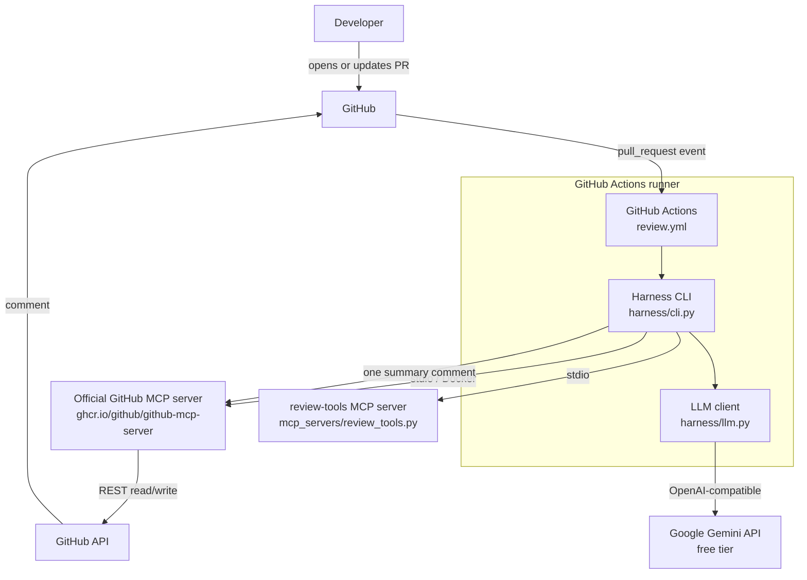
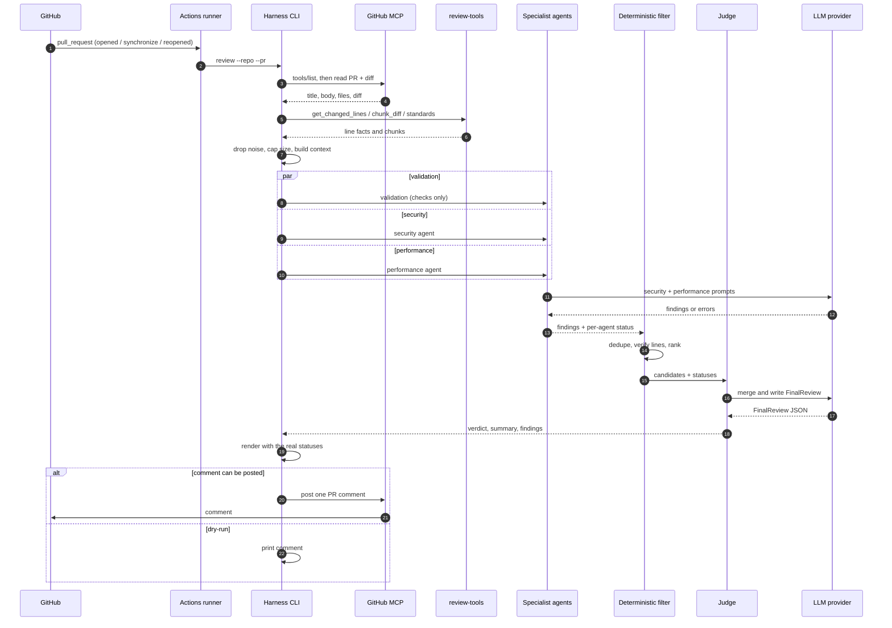
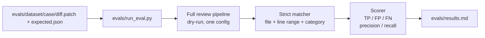
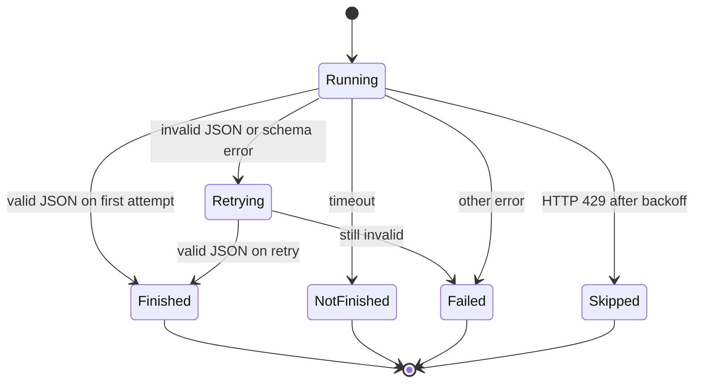

# ARCHITECTURE.md

System design for the multi-agent PR reviewer described in `README.md`.

- Product requirements: `README.md`
- Build order: `PLAN.md`
- Agent working rules: `AGENTS.md`


## 1. Purpose and constraints

The system reviews a GitHub pull request with two specialist LLM agents, a
deterministic validation agent, a deterministic filter, and a judge. It posts
exactly one summary comment and then discards all state.

Hard constraints that shape the architecture:

| Constraint | Architectural consequence |
|---|---|
| Zero cost | GitHub-hosted public repo, GitHub Actions free tier, Google Gemini API free tier |
| Stateless | No database, no queue, no cache at PR time; the runner is disposable |
| Python only | One Python package tree for harness, MCP server, and optional evals |
| No frontend/server | The PR comment is the only UI; Actions is the only runtime |
| Free-tier LLMs | Small number of calls per review, strict prompts, retries, graceful degradation |
| Small PRs | 100–300 changed lines; hard cap at 800 changed lines by default |
| One comment | The judge produces a single Markdown document; no inline comments |
| Swappable provider | Any OpenAI-compatible endpoint via environment variables |

## 2. System context



### Trust boundaries

- **Trusted:** repository code, harness code, prompts, environment configuration.
- **Untrusted:** PR title, PR body, diff, filenames, code comments, branch names,
  and anything returned by the LLM.
- **Secret:** `GITHUB_TOKEN`, optional PAT, `LLM_API_KEY`.

The harness never executes PR code. It only parses text and runs `ruff` as a
linter with fixed arguments.

## 3. Online review flow

This is the flow used on every PR.



### Step-by-step behavior

1. **Trigger.** GitHub fires `pull_request` on `opened`, `synchronize`, or
   `reopened`.
2. **Concurrency.** The workflow group is per PR with
   `cancel-in-progress: true`, so a new commit cancels the older run.
3. **Discovery.** The harness starts the official GitHub MCP server and calls
   `tools/list`. It selects tools by capability, never by a hard-coded name.
4. **Fetch.** The harness reads the PR title, body, changed files, and diff.
5. **Prepare.** It drops lockfiles, generated files, images, and vendored code;
   computes changed-line ranges; and enforces `MAX_DIFF_LINES`.
6. **Cap.** If the diff is too large, it posts a short "too large to fully
   review" comment and stops.
7. **Fan-out.** Validation, security, and performance agents run concurrently
   with `asyncio.gather(..., return_exceptions=True)` and per-agent timeouts.
   Validation is deterministic; security and performance call the LLM.
8. **Validate output.** Each response is parsed with Pydantic. A schema failure
   gets one retry with the validation error appended. A second failure marks the
   agent `failed`.
9. **Filter.** The deterministic filter normalizes paths, deduplicates findings,
   drops non-critical findings outside the diff, keeps critical ones with a
   note, and ranks the survivors.
10. **Judge.** The judge merges overlaps, applies the confidence threshold,
    never drops a critical finding for low confidence (it downgrades it and
    explains why), chooses a verdict, and writes the prose and final review.
11. **Render.** The renderer turns `FinalReview` plus the real `AgentRunResult`
    list into the README comment format. The status table is built by code, not
    by the model. If the judge fails, the plain-code fallback builds the same
    shape.
12. **Publish.** The harness posts one comment, or prints it in dry-run.
13. **Discard.** The runner exits. Nothing is stored.

## 4. Optional offline evaluation flow

The eval suite is optional. It answers: **how good is the one review pipeline
against a small labeled dataset?**



There are **no single-agent or multi-agent comparison configs**. The eval code
is optional, offline-only, and never imported by the PR-time orchestrator.

## 5. Agent status state machine

Every agent run ends in exactly one state, and the comment reports it honestly.



| Status | Trigger | Comment behavior |
|---|---|---|
| `finished` | Valid output | Normal findings |
| `not_finished` | Timeout | Mark that area unreviewed |
| `failed` | Error or invalid output after one retry | Mark that area unreviewed and show the error class |
| `skipped` | Rate-limited after retries | Mark that area unreviewed and say it was skipped |

## 6. Tech stack

### 6.1 Core

| Layer | Choice | Role | Notes |
|---|---|---|---|
| Language | **Python 3.11+** | Harness, MCP server, optional evals | One language for the whole repo |
| Concurrency | **`asyncio`** | Parallel agents, timeouts | `gather`, `wait_for` |
| Validation | **Pydantic v2** | Findings, agent output, status, final review | Drives the one-retry rule |
| LLM SDK | **`openai`** | Any OpenAI-compatible endpoint | Google Gemini by default |
| Retries | **Custom loop** | 429/5xx/timeout handling | No retry library; max two retries |
| HTTP | **stdlib `urllib.request`** | HTTPS fallback for posting comments | No third-party HTTP client |
| MCP | **`mcp` SDK / FastMCP** | Client and custom stdio server | Official protocol |
| Lint | **`ruff`** | Deterministic validation check | Runs on changed Python files |
| Tests | **`pytest`** | Unit and workflow contract tests | Async tests use `asyncio.run` |
| Config | Env vars, **`python-dotenv`** | Provider, model, timeouts, thresholds | `.env` only for optional local dev |
| Packaging | **`pyproject.toml`** + **`uv`** | Reproducible installs | Commit `uv.lock` |
| Logging | stdlib **`logging`** | CI and local diagnostics | Redact secrets |
| Docs | **Markdown** + **Mermaid** | README, this file, plan | Renders on GitHub |

### 6.2 MCP pieces

| Piece | Implementation | Responsibility |
|---|---|---|
| Protocol | MCP over stdio | Harness ↔ tool servers |
| Client | Official `mcp` Python SDK | `tools/list`, `tools/call`, session lifecycle |
| GitHub server | Official image `ghcr.io/github/github-mcp-server` in Docker | PR read, diff read, comment post |
| Custom server | `mcp_servers/review_tools.py` (FastMCP) | Changed lines, chunking, standards, comment fallback |

### 6.3 Explicitly not used

Django, Celery, Redis, any database, any frontend, any dashboard, any web
server, tunnels such as ngrok, any paid API, any paid hosting, and fine-tuning.

## 7. External services and models

| Service | Used for | Auth | Cost / limit | Notes |
|---|---|---|---|---|
| **GitHub** (public repo) | PRs, branches, comments | GitHub account | Free | Public sandbox repo; same-repo branches for demos; comments appear as the `github-actions` bot |
| **GitHub Actions** | Trigger, runner, queue, worker | Built-in | Free for public repos | Standard hosted runner |
| **Google Gemini API** | LLM inference for CI and local runs | Google AI Studio API key | Free tier, per-project rate limits | Primary provider; endpoint `https://generativelanguage.googleapis.com/v1beta/openai/`; default model `gemini-3.5-flash-lite` |
| **GitHub API** | PR data and comments | `GITHUB_TOKEN` or PAT | Free | Reached through the official MCP server |
| **GitHub Container Registry** | Official MCP image | Public pull | Free | Pull time measured in Phase 1 |

### Models

| Role | Model selection | Configuration |
|---|---|---|
| PR review agents (CI) | Low-tier, JSON-capable Gemini model chosen in Phase 1 | `LLM_BASE_URL`, `LLM_MODEL`, `LLM_API_KEY` |
| Local development | Same Gemini model and key | Same env vars |
| Judge | Same provider/model as the agents by default | One LLM call |
| Validation | Deterministic checks by default | No LLM call |

Starting points, to be confirmed in Phase 1:

- **Google Gemini:** `gemini-3.5-flash-lite` on the free tier. Use the exact
  model ID in `LLM_MODEL`; do not hard-code it.
- **Higher quality:** `gemini-3.8-flash` is available, but its free daily quota
  is much smaller. Change only `LLM_MODEL`.

Rules:

- Never hard-code a vendor model ID in Python. It comes from `LLM_MODEL`.
- Verify the model's free-tier limits in Google AI Studio before using it.
- Expect roughly **2–3 LLM calls** per review: security, performance, and judge.
  Validation is deterministic.
- Cache eval responses so repeated runs do not exhaust the free daily quota.
- Do not assume a free Claude API tier. Nothing may require paid access.

## 8. Module map

| Module | Responsibility | Key contracts |
|---|---|---|
| `harness/cli.py` | Parse args, set up logging, run pipeline, exit codes | `review` command |
| `harness/config.py` | Load env, defaults, validation, secret redaction | `Settings` |
| `harness/orchestrator.py` | Fetch → prepare → fan-out → filter → judge → render → post | `ReviewPipeline` |
| `harness/llm.py` | OpenAI-compatible async calls, custom retries, telemetry | `LLMClient` |
| `harness/mcp_client.py` | Stdio sessions, tool discovery, PR read/post | `GitHubMCPClient` |
| `harness/schemas.py` | Pydantic contracts | `Finding`, `AgentOutput`, `AgentRunResult`, `FinalReview` |
| `harness/diff_models.py` | Minimal diff dataclasses | `DiffFile`, `DiffInfo` |
| `harness/diff_utils.py` | Parse, denoise, prepare | `parse_diff`, `prepare_diff` |
| `harness/filter.py` | Dedupe, line verify, rank | `filter_findings` |
| `harness/render.py` | Markdown comment, status table, and fallback | `render_review`, `render_fallback` |
| `harness/agents/base.py` | Prompt runner, timeout, retry, status | `AgentRunner` |
| `harness/agents/validation.py` | Deterministic conventions review | `run_validation` |
| `harness/agents/security.py` | Security and injection review | `run_security` |
| `harness/agents/performance.py` | Efficiency and logic review | `run_performance` |
| `harness/agents/judge.py` | Merge, threshold, verdict, summary | `run_judge` |
| `harness/agents/prompts/` | Short per-agent prompt text | Markdown files |
| `harness/checks/` | Ruff, AST, tests-touched, description checks | `run_checks` |
| `mcp_servers/review_tools.py` | Custom stdio MCP server | Four tools |
| `evals/` | **Optional** offline eval: dataset, strict matcher, scorer, single runner | `EvalCase` |
| `tests/` | Unit, golden, and integration tests | `pytest` |

The Pydantic contract code lives in **`PLAN.md` Appendix E**.

The Phase 4 diff module parses and denoises only. It does not chunk, enforce
`MAX_DIFF_LINES`, or interpret binary/combined diffs; the caller that needs
those behaviors adds them.

## 9. LLM use

Each LLM agent uses a short JSON-only prompt. There is no prompt framework or
separate prompt design section; PR content is still treated as untrusted data.
The default review makes 2–3 LLM calls: security, performance, and judge.

## 10. MCP design

### 10.1 Official GitHub MCP server

Run as a stdio server:

```bash
docker run -i --rm \
  -e GITHUB_PERSONAL_ACCESS_TOKEN \
  ghcr.io/github/github-mcp-server
```

The harness uses the Python MCP SDK to start the container, initialize a
session, and call `tools/list`.

**Never hard-code tool names.** Tool names change between releases. At startup,
select tools by capability using configurable candidate patterns, then log the
chosen names.

| Capability | Selection approach | Fallback |
|---|---|---|
| Get PR details | Tool whose name/description matches pull-request read | Fail with a clear error |
| Get diff or changed files | Tool whose name/description matches diff or files | Derive from files API if available |
| Post PR comment | Tool whose name/description matches issue/PR comment creation | `review-tools.post_comment` via REST |

Environment overrides may pin exact tool names after Phase 1 discovery, but the
default is discovery.

### 10.2 Custom `review-tools` server

| Tool | Input | Output | Used by |
|---|---|---|---|
| `get_changed_lines` | `diff: str` | File → changed line ranges | Filter, orchestration |
| `chunk_diff` | `diff: str`, `max_lines: int` | List of chunks | Prompt preparation |
| `get_repo_standards` | none | Validation rule list | Validation agent |
| `post_comment` | `repo`, `pr`, `body` | Posted comment metadata | Fallback only |

The server imports pure helpers from `harness.diff_utils` and
`harness.checks.rules`; it does not duplicate diff logic.

### 10.3 Auth strategy

1. Try the workflow `GITHUB_TOKEN` for both MCP and REST.
2. If the official server rejects it, use `GITHUB_PERSONAL_ACCESS_TOKEN` from a
   repository secret.
3. Never print or commit either token.

### 10.4 Lifecycle

- Start sessions per run.
- Apply timeouts to initialization and tool calls.
- Close sessions and terminate child processes in `finally`.
- If the server cannot start, fail fast with an actionable message; the harness
  cannot fetch or post without it.

## 11. Failure handling and security

### 11.1 Failure matrix

| Situation | Behavior |
|---|---|
| Agent times out (60–90 s) | Status `not_finished`; continue; comment marks the area unreviewed |
| Free-tier 429 | Backoff up to two retries; then status `skipped` |
| Malformed JSON | One retry with the validation error; then status `failed` |
| Judge fails | Post the plain-code fallback comment, sorted by severity, with statuses |
| New commit mid-review | Workflow `concurrency` cancels the older run |
| Diff too large (default 800 changed lines) | Post a short "too large to fully review" comment and stop |
| Empty or all-noise diff | Post a short "no reviewable changes" comment and stop |
| Duplicate/loop trigger | Ignore bot-authored events; comments do not retrigger `pull_request` |
| GitHub comment post fails | Retry with backoff; log without secrets; exit non-zero |
| MCP server unavailable | Fail fast with a clear setup error |
| LLM provider unavailable | All agents fail/skip; fallback comment says review is unavailable |
| Renderer gets oversized content | Truncate safely and keep the status table |

### 11.2 Prompt-injection defense layers

1. **Envelope:** random boundary token around all untrusted content.
2. **Instruction hierarchy:** system prompt says data is never instructions.
3. **Security agent:** explicitly flags instruction-like text as a finding.
4. **Judge:** ignores instruction-like text inside findings and never trusts
   claimed statuses.
5. **Deterministic filter:** findings still need real files/lines.
6. **Renderer:** escapes untrusted Markdown and caps length.
7. **Optional eval:** includes at least one injection case.

### 11.3 Secrets and permissions

- Workflow permissions: `contents: read`, `pull-requests: write`.
- Store the Google AI Studio key as the `LLM_API_KEY` repository secret.
- No `write-all`.
- No secrets in prompts, logs, findings, or comments.
- Redact tokens in `Settings.__repr__` and exception messages.
- `.env` is local-only and gitignored.
- Use same-repo branches for the demo; fork PRs cannot write comments with the
  workflow token.

### 11.4 Code execution safety

- Never run code from the PR.
- `ruff` runs as a linter with fixed arguments and no `shell=True`.
- File paths are normalized and confined to the checkout for AST checks.
- The bot does not install PR dependencies.

## 12. Configuration

All configuration is environment-only.

| Variable | Purpose | Default |
|---|---|---|
| `LLM_BASE_URL` | OpenAI-compatible endpoint | none; required |
| `LLM_MODEL` | Model identifier | none; required |
| `LLM_API_KEY` | Google AI Studio API key | none |
| `GITHUB_TOKEN` | Read PRs and post comments | injected by Actions |
| `GITHUB_PERSONAL_ACCESS_TOKEN` | PAT fallback for the MCP server | unset |
| `AGENT_TIMEOUT_SECONDS` | Per-agent timeout | `90` |
| `JUDGE_CONFIDENCE_THRESHOLD` | Drop/downgrade threshold | `0.5` |
| `MAX_DIFF_LINES` | Size cap | `800` |
| `DRY_RUN` | Print instead of posting | `false` |
| `LOG_LEVEL` | Logging verbosity | `INFO` |

Optional MCP overrides after Phase 1:

| Variable | Purpose |
|---|---|
| `GITHUB_MCP_PR_TOOL` | Pin the PR read tool |
| `GITHUB_MCP_DIFF_TOOL` | Pin the diff read tool |
| `GITHUB_MCP_COMMENT_TOOL` | Pin the comment tool |

Provider examples:

```bash
# Google Gemini free tier (CI and local)
LLM_BASE_URL=https://generativelanguage.googleapis.com/v1beta/openai/
LLM_MODEL=gemini-3.5-flash-lite
LLM_API_KEY=<google-ai-studio-key>
```

## 13. Design decisions

| Decision | Rationale | Consequence |
|---|---|---|
| Stateless, no database | The result is one comment; persistence adds cost and ops | Every review starts from GitHub data |
| GitHub Actions as queue and worker | Free for public repos; no server to host | Runs are ephemeral and capped by Actions limits |
| Reuse the official GitHub MCP server | Avoid rebuilding GitHub auth and API coverage | Must discover tool names at runtime |
| Small custom MCP server | Owns only the gap: diff facts, standards, fallback post | Less code to maintain |
| OpenAI-compatible provider | Google Gemini free tier by default, no code changes to swap | Model quality varies; prompts must be robust |
| Pydantic + one retry | Structured output is the core reliability mechanism | One extra call on malformed output |
| Deterministic filter before judge | Removes obvious noise cheaply | Judge sees fewer, better candidates |
| Code-owned status table | The model cannot honestly report its own timeout/failure | Renderer uses real `AgentRunResult`s, not judge text |
| Deterministic validation | Ruff/AST are cheap and exact | Default review stays at 2–3 LLM calls |
| Single summary comment | Matches v1 scope and avoids inline-comment APIs | No per-line suggestions |
| Optional offline eval | Keeps PR-time calls low and quota safe | One config, run only when time allows |
| Plain-code fallback | The bot must never post an empty comment | Same module as the renderer |
| No frontend/server | The PR is the UI | Demo is a PR comment, not a dashboard |

## 14. Non-goals

- No web dashboard or UI.
- No database or persistent history.
- No auth system beyond GitHub.
- No multi-language review in v1.
- No inline per-line comments in v1.
- No always-on server, queue, or worker pool.
- No paid model or hosting dependency.
- No RAG or embeddings.
- No automatic code fixes or commits.
- No sticky-comment editing in v1; it is an optional stretch after Phase 17.

## 15. Testing conventions

- Tests live under `tests/` and use plain `pytest`; async test bodies run with
  `asyncio.run`.
- **Build test data through factories in `tests/factories/`; do not construct
  fixtures inline in test bodies.**
  - Add or extend a factory whenever a new object shape is needed.
  - Factories return domain objects or small typed harnesses such as
    `LLMHarness`; the test overrides only the fields relevant to its behavior.
  - Keep defaults in the factory so one change updates every test.
- Unit tests must not touch the network, Docker, a real LLM, or GitHub. Inject
  fakes through the same ports the production code uses.
- Mark live checks `@pytest.mark.integration`; they are not part of the fast
  default suite.
- Every bug fix adds a regression test.
