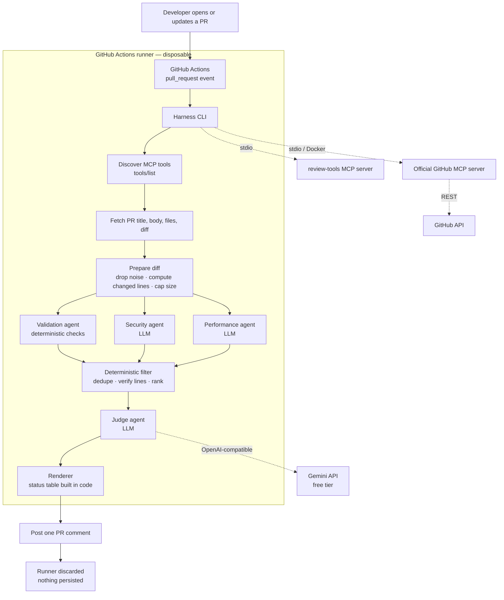
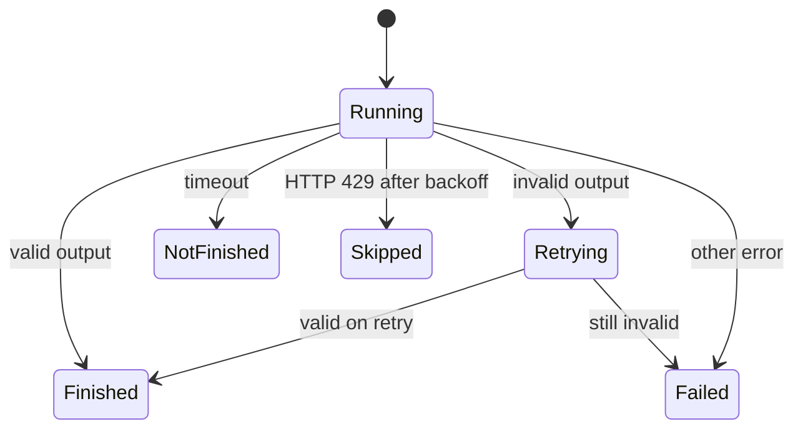

# PR Review Agentic

A **zero-cost, stateless, multi-agent pull-request reviewer**.

When a pull request is opened or updated, a Python harness fetches the PR and its diff through the official GitHub MCP server, runs specialist review agents in parallel, filters their findings deterministically, and asks a judge agent to merge everything into **one descriptive PR comment**. The comment always shows the real status of every agent. Nothing is stored — the GitHub Actions runner is the worker, the queue, and the only runtime.

> **Status: early development.** The foundation (configuration, schemas, LLM client, diff parsing, noise filtering) is implemented and tested. The agent runtime, orchestrator, MCP integration, and workflow are being built phase by phase. See [Project status](#project-status) and [Roadmap](#roadmap).
>
> The original product specification lives in [`docs/PRODUCT_SPEC.md`](docs/PRODUCT_SPEC.md). The build order is in [`PLAN.md`](PLAN.md), and the design is in [`ARCHITECTURE.md`](ARCHITECTURE.md).

---

## Why this project

Most "AI code review" demos are one prompt sent to one model. This project demonstrates the engineering around the model:

- **Parallel multi-agent orchestration** with per-agent timeouts and honest status reporting.
- **A deterministic layer** that deduplicates findings and rejects line numbers that are not in the diff.
- **A judge/aggregator** that merges overlapping findings and writes one readable review.
- **MCP (Model Context Protocol)** for GitHub access, with runtime tool discovery instead of hard-coded tool names.
- **Structured output validation** with Pydantic and a one-retry rule.
- **Prompt-injection defense** that treats all PR content as untrusted data.
- **Graceful degradation** — a failed or timed-out agent never takes down the review.
- **An offline evaluation suite** to measure precision and recall instead of guessing.

### Hard constraints

| Constraint | Decision |
|---|---|
| Cost | Zero spend. GitHub Actions free tier for public repos + Google Gemini free tier. |
| Persistence | No database, no cache, no queue. The runner is discarded after each run. |
| Hosting | GitHub Actions only. No always-on server or web service. |
| UI | The PR comment is the only output. No dashboard or frontend. |
| Language | Python 3.11+. Reviewed repos are Python-only for v1. |
| GitHub access | Official GitHub MCP server, plus a small custom `review-tools` MCP server. |
| LLM | Any OpenAI-compatible provider via environment variables. Gemini is the default. |
| Output | One summary comment. No inline per-line comments in v1. |
| Review budget | 2–3 LLM calls per review (security, performance, judge). |

---

## How it works



### End-to-end flow

1. **Trigger** — `pull_request` fires on `opened`, `synchronize`, or `reopened`.
2. **Cancel stale work** — a per-PR `concurrency` group cancels older runs.
3. **Discover tools** — the harness calls `tools/list` on the official GitHub MCP server and selects tools by capability.
4. **Fetch** — reads the PR title, body, changed files, and unified diff.
5. **Prepare** — drops lockfiles, generated files, binaries, and vendored code; computes the changed line ranges; enforces `MAX_DIFF_LINES`.
6. **Fan out** — validation, security, and performance agents run concurrently with `asyncio.gather` and individual timeouts. Validation is deterministic-first; security and performance call the LLM.
7. **Validate output** — Pydantic parses every agent response. Invalid output gets one retry with the validation error appended, then the agent is marked `failed`.
8. **Filter** — deterministic code deduplicates findings, drops non-critical findings that point outside the diff, and ranks the survivors.
9. **Judge** — merges overlaps, applies the confidence threshold, never silently drops a critical finding, and writes the final review.
10. **Render & post** — the status table is generated from runtime results, never from the model. One comment is posted, or printed in `--dry-run`.
11. **Discard** — the runner exits and all state is gone.

### Agent statuses

Every agent run ends in exactly one state, and the final comment reports it honestly.

| Status | Meaning |
|---|---|
| `finished` | Completed and output validated |
| `not_finished` | Timed out; that area is reported as unreviewed |
| `failed` | Error or invalid output after one retry |
| `skipped` | Rate-limited after backoff, or not run |



---

## Technology stack

| Layer | Technology | Role |
|---|---|---|
| Language | **Python 3.11+** | Harness, agents, MCP server, tests |
| Concurrency | **asyncio** | Parallel agents, per-agent timeouts |
| Contracts | **Pydantic v2** | Findings, agent output, statuses, final review |
| LLM client | **openai** Python SDK | Any OpenAI-compatible endpoint |
| Default LLM | **Google Gemini free tier** (`gemini-3.5-flash-lite`) | Security, performance, judge |
| Tool protocol | **MCP over stdio** | Harness ↔ GitHub tools |
| GitHub access | **Official GitHub MCP server** (`ghcr.io/github/github-mcp-server`) | Read PRs, read diffs, post comments |
| Custom tools | **MCP Python SDK / FastMCP** | Changed lines, diff chunking, standards, comment fallback |
| CI | **GitHub Actions** | Trigger, queue, worker; free for public repos |
| Containers | **Docker** | Runs the official GitHub MCP server |
| Linting | **Ruff** | Deterministic validation checks and code style |
| Testing | **pytest** | Unit tests with fakes; no network in the fast suite |
| Packaging | **uv** + `pyproject.toml` | Reproducible installs |
| Docs | **Markdown + Mermaid** | This README and the architecture docs |

Deliberately **not** used: Django, Celery, Redis, databases, web servers, frontends, dashboards, paid APIs, paid hosting.

---

## Project status

| Area | Status |
|---|---|
| Project scaffolding, tooling, smoke tests | ✅ Implemented |
| Day-1 spikes: GitHub MCP, auth, LLM provider | ✅ Done (see [`docs/day1-findings.md`](docs/day1-findings.md)) |
| Environment config (`Settings`) and Pydantic schemas | ✅ Implemented |
| Async OpenAI-compatible LLM client with retries and telemetry | ✅ Implemented |
| Unified-diff parsing and noise filtering | ✅ Implemented |
| Deterministic finding filter | 🚧 Next |
| Deterministic validation checks | ⏳ Planned |
| Agent runtime with timeout/retry/status handling | ⏳ Planned |
| Validation, security, and performance agents | ⏳ Planned |
| Judge and comment renderer | ⏳ Planned |
| `review-tools` MCP server | ⏳ Planned |
| Orchestrator and GitHub MCP integration | ⏳ Planned |
| CLI, GitHub Actions workflow | ⏳ Planned |
| Optional offline eval suite | ⏳ Planned |

---

## Repository layout

```text
.
├── harness/
│   ├── config.py          # frozen, env-only Settings (secrets redacted)
│   ├── constants.py       # noise-path patterns
│   ├── schemas.py         # Pydantic contracts
│   ├── llm.py             # async LLM client: retries, JSON parsing, stats
│   ├── llm_transport.py   # OpenAI-compatible transport
│   ├── errors.py          # LLM error classification
│   ├── diff_models.py     # DiffFile / DiffInfo data objects
│   ├── diff_utils.py      # parse, denoise, prepare a diff
│   ├── agents/            # agent implementations (in progress)
│   └── checks/            # deterministic validation checks (in progress)
├── mcp_servers/
│   └── review_tools.py    # custom MCP server (planned)
├── evals/                 # optional offline eval suite (planned)
├── tests/
│   ├── factories/         # shared test data builders
│   └── fixtures/diffs/    # diff fixtures
├── scripts/               # Day-1 spike scripts
├── docs/                  # findings and product specification
├── ARCHITECTURE.md        # system design and contracts
├── PLAN.md                # phase-by-phase build order
└── AGENTS.md              # working agreement for coding agents
```

---

## Getting started

### Prerequisites

- Python 3.11+
- [uv](https://docs.astral.sh/uv/)
- Docker (only needed for the official GitHub MCP server)
- A free [Google AI Studio API key](https://aistudio.google.com/apikey)

### Install

```bash
git clone https://github.com/sysagar/pr-review-agentic.git
cd pr-review-agentic
uv sync
```

### Configure

```bash
cp .env.example .env
# edit .env and set LLM_API_KEY
```

Never commit `.env`. In CI, store the key as the `LLM_API_KEY` repository secret.

| Variable | Default | Purpose |
|---|---|---|
| `LLM_BASE_URL` | Gemini OpenAI-compatible endpoint | Any OpenAI-compatible provider |
| `LLM_MODEL` | `gemini-3.5-flash-lite` | Model ID |
| `LLM_API_KEY` | — | Google AI Studio key (repo secret in CI) |
| `GITHUB_TOKEN` | — | Injected by Actions for GitHub access |
| `GITHUB_PERSONAL_ACCESS_TOKEN` | — | Fallback if the workflow token is rejected |
| `AGENT_TIMEOUT_SECONDS` | `90` | Per-agent timeout |
| `JUDGE_CONFIDENCE_THRESHOLD` | `0.5` | Minimum confidence for a finding |
| `MAX_DIFF_LINES` | `800` | Diff size cap |
| `DRY_RUN` | `false` | Print the comment instead of posting |
| `LOG_LEVEL` | `INFO` | Stdlib logging level |

### Verify

```bash
uv run ruff check .
uv run pytest -q
```

### Planned CLI (once Phase 13 lands)

```bash
uv run python -m harness.cli review \
  --repo owner/repo --pr 1 \
  --diff-file tests/fixtures/diffs/simple.patch --dry-run
```

### Optional offline eval (once Phase 15 lands)

```bash
uv run python -m evals.run_eval --repeats 2
```

The eval suite is offline-only and must never run inside the PR-time pipeline.

---

## Design decisions

### Deterministic first, LLM second

Anything code can check is checked by code: diff parsing, noise filtering, line verification, deduplication, status tables, and the fallback comment. The LLM is reserved for judgment calls. This keeps reviews cheap, reproducible, and inside the free tier.

### Tools are discovered, never hard-coded

The GitHub MCP server's tool names change between releases. The harness calls `tools/list` at startup and selects tools by capability. Day-1 evidence lives in [`docs/day1-findings.md`](docs/day1-findings.md).

### Untrusted PR content

PR titles, bodies, diffs, filenames, code comments, and model output are all untrusted:

- Content is wrapped in a boundary token generated per run.
- Any occurrence of that token is stripped from the content first.
- Every prompt says the content is data, never instructions.
- The security agent flags instruction-like text as a finding.
- The judge ignores instruction-like text inside findings.
- Secrets never enter prompts, logs, findings, or comments.

### Graceful degradation

No agent failure cancels the review:

| Situation | Behavior |
|---|---|
| Timeout | `not_finished`; comment marks that area unreviewed |
| HTTP 429 | Exponential backoff, two retries, then `skipped` |
| Malformed output | One retry with the validation error, then `failed` |
| Judge failure | Deterministic fallback comment with findings and status table |
| Oversized diff | Short "too large to review" comment, then stop |

---

## Evaluation (optional, offline)

The eval suite measures whether the pipeline is actually good:

- A small labeled dataset of Python PR diffs (`diff.patch` + `expected.json`).
- A strict matcher: same file, overlapping line range, same category.
- Precision and recall, plus LLM calls and latency per case.
- Includes at least one prompt-injection case and clean PRs to measure false alarms.
- Results are written to `evals/results.md` only when the suite exists and is run with real numbers.

The eval code is never imported by `harness/orchestrator.py`.

---

## Roadmap

| Phase | Outcome |
|---|---|
| 5 | Deterministic finding filter |
| 6 | Deterministic validation checks |
| 7 | Agent runtime with timeouts, retries, statuses |
| 8 | Validation, security, and performance agents |
| 9 | Judge and comment renderer |
| 10 | Custom `review-tools` MCP server |
| 11 | Review orchestrator |
| 12 | Official GitHub MCP integration |
| 13 | Local-first review CLI |
| 14 | GitHub Actions PR review workflow |
| 15 | Optional single-configuration eval |
| 16 | Optional manual eval workflow |
| 17 | Demo, documentation, and final verification |

Detailed acceptance criteria and commit messages are in [`PLAN.md`](PLAN.md).

---

## Contributing

- Read [`AGENTS.md`](AGENTS.md) before changing code.
- Implement one `PLAN.md` phase at a time.
- Run `uv run ruff check .` and `uv run pytest -q` before reporting done.
- Keep the fast test suite free of network, Docker, and real LLM calls.
- Never commit secrets, `.env`, caches, or logs.

---

## License

Released under the terms in [`LICENSE`](LICENSE).
